<!-- This file is generated from templates/README.tpl.md by scripts/build.py. Edit the template, not README.md. -->

[LinkedIn](https://www.linkedin.com/in/harshil-sri/) · [Email](mailto:thisisharshil@gmail.com) · [Endorse me](#endorsements)

## Harshil Srivastav

AI/ML student at VIPS-TC, working on computer vision, audio deepfakes and ML systems. I like problems where the data is messy and the results have to hold up outside the notebook: compressed audio, documents with almost no labels, network traffic that only flows one way.

### Right now

- **[harshil-sri/ego-vision](https://github.com/harshil-sri/ego-vision)**: Do not count the same labeller&#x27;s egoextra-4 result either (1 day ago)
- **[harshil-sri/nanogpt](https://github.com/harshil-sri/nanogpt)**: Add README with model details, loss curve and sample output (5 days ago)
- **[harshil-sri/openvino](https://github.com/harshil-sri/openvino)**: [NPUW] LongRoPE: detect exports without rotary Broadcast (#40088) (6 days ago)
- **[harshil-sri/opencv](https://github.com/harshil-sri/opencv)**: Merge pull request #31008 from sshivensolanki/dnn-eyelike-uint32-uint64 (6 days ago)

### Projects

**[ego-vision](https://github.com/harshil-sri/ego-vision)**: egocentric video research. 
 
A head-mounted camera follows someone through a task, and a VideoMAE verb model with a recipe state machine tracks their progress live. The research part asks *when* human instructors choose to speak during hands-on work. On HoloAssist, instructors rarely start talking during screw, unscrew and insert actions (0.28–0.46× the base rate). A pre-registered rating study with 14 raters tests whether timing matters, and the replications on WTaG and Ego-EXTRA are reported as failed replications.
`PyTorch` `VideoMAE` `DINOv2` `EPIC-KITCHENS`

**[deep-voice-defender](https://github.com/harshil-sri/deep-voice-defender)**: deepfake voice detection that survives WhatsApp. 
 
Most detectors fail once audio goes through messaging-app compression. During training, a corruption layer applies Opus re-encoding, resampling and noise. Evaluated with the official EER and min t-DCF; best dev EER is 2.5–4.0% with full augmentation, from a 15-run ablation grid.
`TensorFlow` `Audio` `Kaggle GPUs`

**[mvss-net-lite](https://github.com/harshil-sri/mvss-net-lite)**: document forgery localisation (CDAC research internship). 
 
A dual-stream ResNet-34 (RGB and noise/edge views) with attention fusion localises tampered regions at the pixel level. A FastAPI service turns the predictions into readable forensic reports. [Weights in the release.](https://github.com/harshil-sri/mvss-net-lite/releases)
`PyTorch` `FastAPI` `CASIA` `DEFACTO` `MIDV-500`

**[SIH-2026](https://github.com/harshil-sri/SIH-2026)**: threat detection behind a data diode (Smart India Hackathon, team HarTimeError). 
 
Forward-only traffic features feed an XGBoost classifier, an LSTM autoencoder and protocol detectors, fused into one threat score and streamed to a live operator console.
`XGBoost` `LSTM` `FastAPI` `WebSockets` `React`

**[rsna-knee](https://github.com/harshil-sri/rsna-knee)**: Kaggle RSNA Knee Abnormality Detection, 0.956 macro-AUC. 
 
Only 58 of 4,407 MRI studies had labels, so I built weak labels from radiology reports, validated against the 58, and trained 2.5D ConvNeXt models.
`PyTorch` `timm` `DICOM`

**Hackathon builds:** [delegates](https://github.com/harshil-sri/delegates) (AI advocates negotiate and humans sign off) · [prometheus](https://github.com/harshil-sri/prometheus) (closed-loop fraud detection, Mastercard Innovation Challenge) · [Quorum](https://github.com/Chirag-agg/Quorum-qualcomm-hack) (edge-first LLM routing, Qualcomm hackathon)

**Smaller things:** [ScrollSaver](https://github.com/harshil-sri/ScrollSaver) (a Telegram bot that turns saved Reels into Notion notes) · [logic-lobby-v2](https://github.com/harshil-sri/logic-lobby-v2) (an on-campus recruitment puzzle hunt) · [micrograd](https://github.com/harshil-sri/micrograd) and [makemore](https://github.com/harshil-sri/makemore) (Karpathy's Zero to Hero, worked through by hand)

### Stats

  
  

### Endorsements

Worked with me? Open a skill below and react with 👍. Your avatar shows up here within a few hours.

- [PyTorch](https://github.com/harshil-sri/harshil-sri/issues/1)
- [Computer Vision](https://github.com/harshil-sri/harshil-sri/issues/2)
- [Audio &amp; Deepfake Detection](https://github.com/harshil-sri/harshil-sri/issues/3)
- [FastAPI &amp; ML Backends](https://github.com/harshil-sri/harshil-sri/issues/4)
- [React &amp; TypeScript](https://github.com/harshil-sri/harshil-sri/issues/5)
- [Shipping at Hackathons](https://github.com/harshil-sri/harshil-sri/issues/6)

### Tools

Python, PyTorch, TensorFlow, scikit-learn, XGBoost, FastAPI, React/TypeScript, Docker, Kaggle, Linux

### Contact

[LinkedIn](https://www.linkedin.com/in/harshil-sri/) · thisisharshil@gmail.com

This page rebuilds itself every few hours with GitHub Actions. Last refreshed 28 Nov 2026, 05:01 IST.
